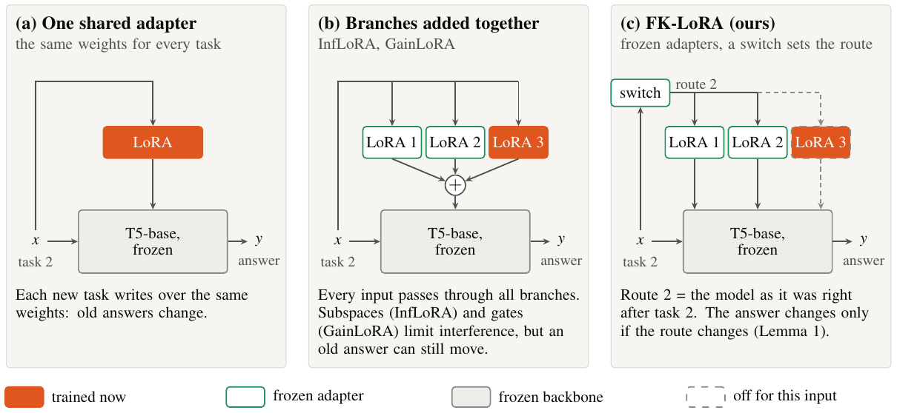
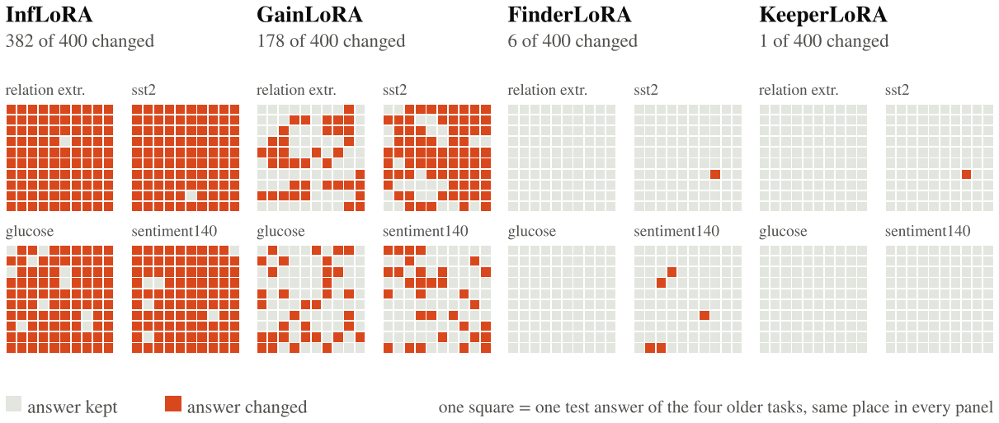

# FK-LoRA

Code, results and paper for

**Never Forget What You Learn: FK-LoRA for Continual Learning Without Forgetting**
Shivkumar Bammidi and Abhishek Jangid, EnLab.

[](https://doi.org/10.5281/zenodo.24396122)

**The paper: [`FK-LoRA.pdf`](FK-LoRA.pdf)** (70 pages with appendix), published on Zenodo:
<https://doi.org/10.5281/zenodo.24396122>.

Its LaTeX sources and other versions are in `paper_certified/`: `main_compact.pdf` (built from the
LaTeX sources), `main.pdf` (the same content at full length) and `short.pdf` (a 9-page version with
appendix).

## The idea

A frozen language model learns tasks one after another. Each task gets its own small LoRA adapter,
and an adapter is never changed after its task has been learned. At test time a *switch* sets the
*route* of every input: route *j* means "answer with the model as it was right after task *j*".
With frozen adapters an answer can change only if its route changes (Lemma 1 of the paper), so
forgetting becomes a question about the rule that sets the route.



FK-LoRA ("finders keepers") has three rules for the route:

| Rule | What it reads | What it gives |
|---|---|---|
| **FinderLoRA** (recommended) | the example itself, through frozen states of the model; no instruction | blocks no task; an audit of changed answers from held-out inputs |
| **KeeperLoRA** | the same | a bound, known in advance, on how many inputs a later task can take from an older one |
| **ClaimLoRA** | the instruction of the input | a certificate: the answer to an input inside a protected zone can never change |

## Main result

Reduced setting: T5-base, five tasks of SuperNI learned in sequence, **no task definition in the
input**, official code of GainLoRA for training and scoring. Scores are Rouge-L (0 to 100).

100 epochs per task, seed 42:

| Method | Score right after learning | Score after the last task | Answers changed (of 400) |
|---|---|---|---|
| InfLoRA | 78.37 | 25.37 | 382 |
| GainLoRA | 76.29 | 56.41 | 178 |
| FinderLoRA (ours) | 80.78 | 80.18 | 6 |
| KeeperLoRA (ours) | 80.78 | 80.98 | 1 |

10 epochs per task, mean of three seeds: after the last task InfLoRA 38.92, GainLoRA 51.02,
FinderLoRA 77.22, KeeperLoRA 77.68; answers changed of 1,200: 746, 414, 18 and 3.



What this does and does not show:

* It is a small model and a reduced setting; the 100-epoch runs have one seed. We make no claim
  about the state of the art.
* InfLoRA and GainLoRA were run by us, with their official code, on inputs without the task
  definition. With the definition left in, the same two methods at 100 epochs forget far less
  (3.47 and 0.21 points): the instruction was what kept their answers.
* A certificate of ClaimLoRA promises that an answer will not change. It does not promise that the
  input was given to the right task.

All numbers, all limits and the tests that failed are in the paper.

## What is where

| Path | Content |
|---|---|
| `paper_certified/` | the paper (LaTeX sources, PDF, Word copies), the scripts that make every table and figure from the result files (`make_results.py`, `audit_results.py`, `make_figures.py`, ...), and the route studies that run on a CPU |
| `silent_adapters/` | the GPU runs: notebooks for Kaggle or Colab (one T4), the launcher, and `results/` with the archive of every run (every score and every answer) |
| `silent_adapters/PLAN.md` | the plan: for every test, what would count as success and as failure, written before the test was run, and the reading of the result afterwards |
| `RESULTS_LOG.md` | the dated log of every run |
| `certified_switch/` | stand-alone code of the switch and the recogniser, with small demos that train on a CPU or a small GPU |
| `latent_lora/` | an earlier attempt that is reported in the appendix |

## Rebuild the paper from the result files

```bash
cd paper_certified
python3 make_results.py && python3 audit_results.py && python3 widen_results.py
python3 polish_tables.py && python3 make_figures.py
pdflatex main_compact && bibtex main_compact && pdflatex main_compact && pdflatex main_compact
```

`audit_results.py` checks every number of the newer sections against the run archives and stops
if one differs. Python 3.10 or newer with `numpy`, `matplotlib` and `pillow`; a LaTeX
installation for the PDF.

## Run the experiments

* **Small demo:** see `certified_switch/README.md`.
* **GPU runs of the paper:** open a notebook of `silent_adapters/` on Kaggle or Colab (one NVIDIA
  T4). The notebook builds its own Python environment, clones the official GainLoRA repository at
  commit `e9d0d70` and writes the launcher itself. `silent_adapters/README.md` lists the notebooks.
* **Route studies on a CPU:** the `*_study.py` scripts of `paper_certified/`. They keep models and
  data in a scratch folder; set `FK_LORA_SCRATCH` to choose it.

## Cite

Bammidi, S., & Jangid, A. (2026). *Never Forget What You Learn: FK-LoRA for Continual Learning
Without Forgetting* (Version v1). Zenodo. https://doi.org/10.5281/zenodo.24396122

```bibtex
@misc{bammidi2026fklora,
  title     = {Never Forget What You Learn: {FK-LoRA} for Continual Learning Without Forgetting},
  author    = {Bammidi, Shivkumar and Jangid, Abhishek},
  year      = {2026},
  version   = {v1},
  publisher = {Zenodo},
  doi       = {10.5281/zenodo.24396122},
  url       = {https://doi.org/10.5281/zenodo.24396122}
}
```
